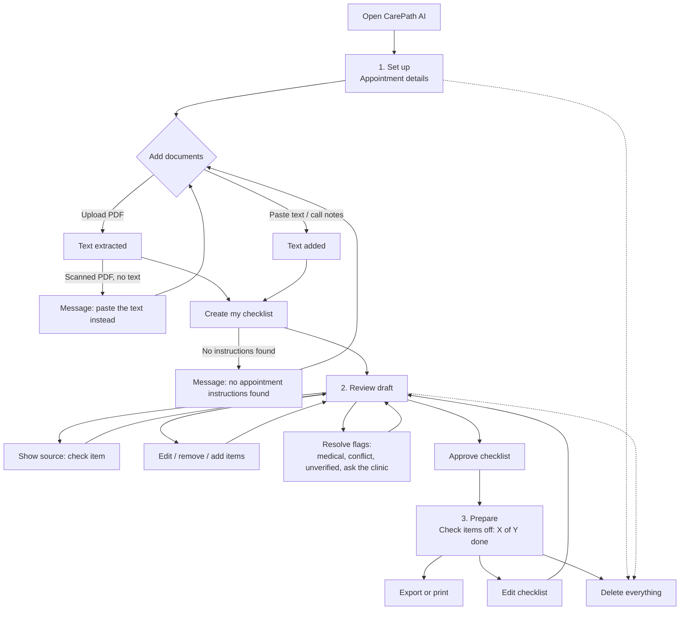

# UX Design: User Flow, Information Architecture & Wireframes

**Stage:** 7, UX & Product Design
**Status:** 🟡 v0.1 wireframes. To be tested with users.
**Wireframes:** [Interactive design canvas](https://claude.ai/artifact/FEvitTPi9QAPwfRSywkc5m) (private until shared; for the portfolio, export the screens as images into this folder)
**Inputs:** [PRD](../05-prd/prd.md) · [Proto-personas](../03-research/proto-personas.md) · [Interim findings](../02-discovery/findings.md)

> All names, dates, clinics, and document text in the wireframes are **synthetic examples**.

---

## 1. Design principles (from research)

| Principle | Why (evidence) | How it shows up |
|---|---|---|
| **Show, don't ask for trust** | Only 15% of people would share health data with health-tech companies ([desk research](../02-discovery/desk-research.md)) | Every item has a source chip and a **Show source** button that highlights the exact passage |
| **Plain language, readable type** | Only 12% of US adults have proficient health literacy | Short, one-action items; 17px base text; **Atkinson Hyperlegible**, a typeface designed for readability |
| **The patient decides** | Human-in-the-loop requirement (PRD §8) | Draft → review → **Approve**; edit, remove, and add on every item |
| **Never choose for the patient** | Safety rule FR-4.3 | Conflicts show both versions side by side: "CarePath AI doesn't choose for you" |
| **Make gaps visible, not scary** | "Missing information" finding | A calm "Ask the clinic" section, phrased as questions, labeled "Not in your documents" |
| **Ask for as little data as possible** | Trust is the biggest adoption risk | "Only add what you need" notice; paste-text option; nothing saved; Delete everything is always visible |

---

## 2. User flow



**Three steps, always visible** in a progress indicator: *Set up → Review draft → Prepare*. First-time patients are anxious; knowing where they are and what's next reduces that.

---

## 3. Information architecture

```
CarePath AI (single session, no account)
├── Global (every screen)
│   ├── "Not medical advice" notice          FR-4.6
│   ├── Delete everything                    FR-7.2
│   └── Progress: 1 Set up · 2 Review · 3 Prepare
├── 1. Set up & add documents
│   ├── Your appointment: specialty, date, clinic (optional)     FR-1.1
│   ├── Your documents
│   │   ├── Upload PDF (≤5 files, 10 MB)                         FR-1.2
│   │   ├── Paste text + label (e.g. call notes)                 FR-1.4
│   │   └── Added list: D1, D2, D3… with Remove; scanned-PDF error   FR-1.3
│   ├── "Only add what you need" privacy notice                  FR-1.5, FR-7.3
│   └── Create my checklist
├── 2. Review draft
│   ├── Label legend
│   ├── Sections: Bring · Do · Before [date] · Ask the clinic    FR-2.3
│   │   └── Item: text, source chip (D2 · C2), label, Show source / Edit / Remove
│   ├── Add your own item                                         FR-6.2
│   ├── Source panel: document tabs, numbered chunks, highlighted quote   FR-3.3
│   └── Approve checklist                                         FR-6.3
└── 3. Prepare
    ├── Appointment summary
    ├── Progress: "X of Y done" + bar                             FR-6.4
    ├── Checklist with checkboxes (labels kept)
    ├── Export or print                                           FR-6.5
    └── "Nothing is saved" reminder                               FR-7.1
```

**Source IDs:** each document gets a short ID (**D1, D2, D3**) on screen 1, and each passage a chunk ID (**C1, C2…**). The same IDs appear on checklist items and in the source panel, so the patient can match them.

---

## 4. Screens

### Screen 1: Set up & add documents
- **Goal:** get the patient's instructions in, with minimal effort and minimal data.
- **Key decisions:**
  - **Paste text sits next to upload as an equal option**, not hidden. It covers phone-call notes (the "spoken and forgotten" problem) and patients with paper documents.
  - A **scanned PDF error appears in the list** with a fix ("paste the text instead") rather than as a blocking pop-up.
  - The privacy notice explains *what happens to the text* in one sentence.
- **Requirements:** FR-1.1–1.5, FR-7.3 · **Stories:** US-0, US-1, US-2

### Screen 2: Review draft checklist (the core screen)
- **Goal:** let the patient check and correct the AI's draft before relying on it.
- **Key decisions:**
  - **Split layout:** checklist on the left, **source panel** on the right (stacks on a phone). Clicking **Show source** highlights the exact passage. This is the main trust mechanism.
  - **Five labels, each with an icon and text** (never color alone): Source verified · Medical instruction · Conflicting instructions · Not in your documents · Couldn't verify source.
  - **Medical instructions** are shown in quotation marks in the original wording, with "Confirm with your care team if you have questions."
  - **Conflicts** show both quotes side by side, each with its own source, plus "Ask the clinic which time is correct."
  - **Unverified items** (the quote wasn't found in the source) get a dashed border and a plain explanation. The example in the wireframe ("Garage B on Elm Street") shows what a hallucination looks like when it's caught.
  - **Ask the clinic** is its own section with a short, calm explanation, not a warning.
- **Requirements:** FR-2.3, FR-3.1–3.3, FR-4.2–4.3, FR-5.2–5.3, FR-6.1–6.3 · **Stories:** US-3 to US-8

### Screen 3: Prepare & track progress
- **Goal:** turn the approved list into a simple to-do list that ends in "You're ready."
- **Key decisions:**
  - Large **"4 of 9 done"** progress, with a bar; a short "You're ready for your appointment" message at 100%.
  - **Labels stay visible** after approval (medical, ask the clinic, edited by you, added by you), so context isn't lost.
  - **"Write down my questions for the doctor"** appears as a user-added item. It connects to the "forgot my questions" pain without the product generating questions.
  - **Export or print** is the primary action, because nothing is saved.
- **Requirements:** FR-6.4–6.5, FR-7.1 · **Stories:** US-9, US-10

---

## 5. States to design (not all drawn yet)

| State | What the patient sees |
|---|---|
| No documents yet | "Create my checklist" disabled, with the hint "Add at least one document" |
| Processing (≤30 seconds) | Progress message: "Reading your documents…" then "Checking sources…" |
| Scanned PDF | Inline error with "paste the text instead" (drawn) |
| No instructions found | "We didn't find appointment instructions in these documents." with a link back |
| AI output invalid twice | "Something went wrong creating your checklist. Your documents are still here. Try again." |
| Medical question typed | "CarePath AI can't answer medical questions. Please ask your care team." |
| Delete everything | Confirmation dialog → "All your documents and checklist data have been deleted." |
| All items done | "You're ready for your appointment." (drawn) |

---

## 6. Visual & accessibility decisions

| Decision | Detail |
|---|---|
| Typeface | **Atkinson Hyperlegible** (designed for low-vision readers; clear letterforms) for all text; IBM Plex Mono for source IDs only |
| Base size | 17px body, 22px section headings, 36px page titles |
| Colors | **Light blue and white:** light blue page background (#EEF6FC), white cards, blue primary (#1F6FB2, 5.3:1 on white); text and labels chosen to meet **WCAG 4.5:1 contrast**. Warning labels (medical, conflict, ask the clinic) keep their own colors so they stay easy to tell apart |
| Not color alone | Every label pairs an **icon and words**; conflicts and medical instructions differ in lightness, not only hue |
| Touch targets | All buttons and links ≥ 44px tall |
| Real controls | Real buttons, links, inputs with labels, checkboxes, so keyboard and screen readers work |
| Responsive | Two-column review screen stacks into one column on a phone |
| No decoration | No gradients, emoji, or stock images: a calm, utility look for an anxious moment |

---

## 7. Usability test plan (5 participants)

**Who:** people matching the proto-personas (recent first-time specialist patients). **How:** 20-minute remote sessions with the clickable wireframes; think-aloud.

| # | Task | Success looks like | Tests |
|---|---|---|---|
| 1 | "Add your phone call notes." | Finds Paste text without help | Paste text is discoverable |
| 2 | "Check where 'Photo ID' came from." | Uses Show source; finds the highlighted passage | Citation UX |
| 3 | "What should you do about the arrival time?" | Says they'd ask the clinic | Conflict design |
| 4 | "Is there anything you should ask the clinic?" | Finds both questions; understands why they're there | Missing-information UX |
| 5 | "You're done preparing. Show me." | Checks items; reads progress | Progress tracking |

**Also ask:** "How much would you trust this checklist, from 1 to 5? Why?" and "Would you upload your real documents? What would stop you?" (tests assumptions #5 and #6).

**Success bar:** 4 of 5 participants complete each task without help.

---

## 8. Open design questions
1. Is "Ask the clinic" helpful or worrying? (Test it: watch for anxiety.)
2. Do patients understand source IDs like "D2 · C2", or do they need document names?
3. Should the Prepare screen offer a call-the-clinic shortcut (the phone number is often in the documents)?
4. Would Daniel ("The Busy Professional") want reminders enough to justify the cost (feature F14)?

## 9. Figma
The wireframes were built on an [interactive design canvas](https://claude.ai/artifact/FEvitTPi9QAPwfRSywkc5m); the screens link together and can be clicked through. To also show Figma skills, recreate Screen 2 in Figma from these wireframes, or export the canvas as images and import them. Add the Figma link here when done.
